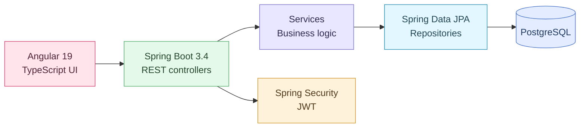

# 🛒 E-Commerce — portfolio overview

This project demonstrates the engineering of a complete web application: frontend, backend, persistence and security. It is not an AI product, and that distinction is intentional — it complements the AI-focused repositories with software engineering fundamentals.

## Architecture

## Capabilities

- Product catalogue, categories and product details
- User registration and authentication
- Shopping carts, checkout, orders and order history
- Payment/transaction and shipping-related domain functionality
- Reviews, wishlists and user/admin views

The diagram is an overview. Security properties and payment integrations need their own review before any production use.

## Read the implementation

- [Backend](../Spring/Spring/) — Java 17, Spring Boot 3.4, JPA, Security and REST controllers
- [Frontend](../frontend/) — Angular 19 and TypeScript
- [Setup and testing](../README.md#running-the-project) — environment, commands and test tooling

## Quality checks

The [portfolio CI workflow](../.github/workflows/portfolio-ci.yml) compiles the Java backend and builds the Angular frontend. It does not run database-backed end-to-end tests or certify security correctness.
